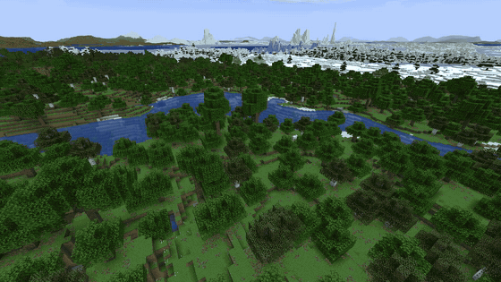
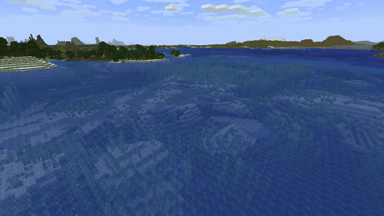
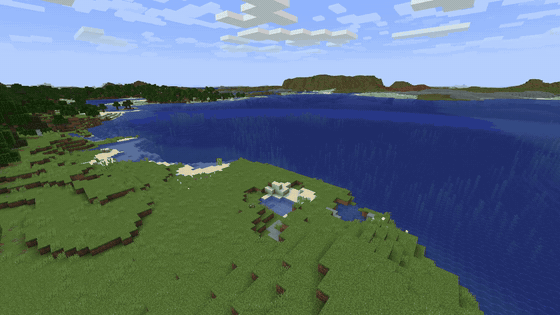
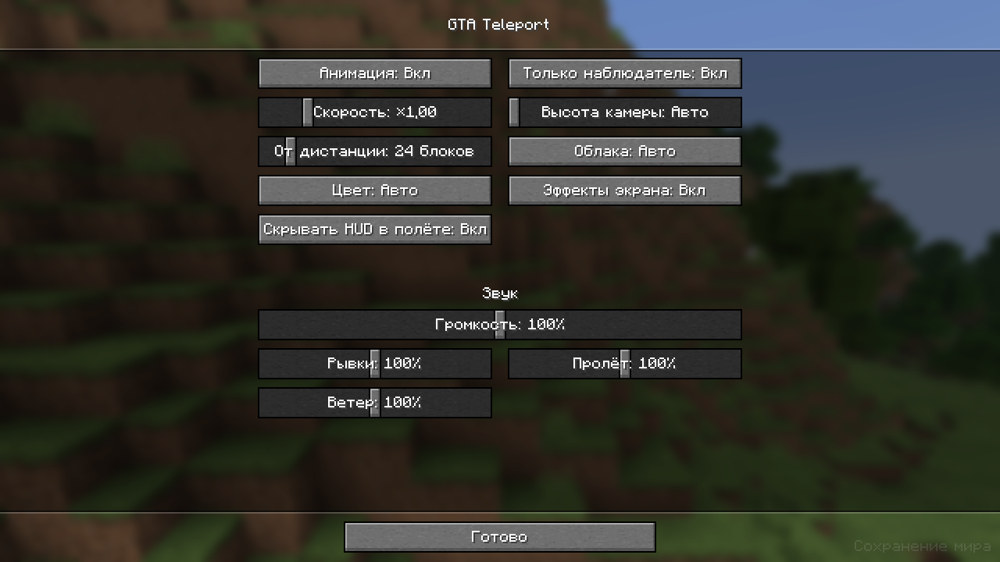

# GTA Teleport

Клиентский мод на Fabric для **Minecraft Java 26.3**. Телепорт в режиме наблюдателя проигрывает переключение
персонажа из GTA V вместо мгновенной склейки: камера рывками уходит в небо, пролетает над картой и опускается к
цели.



Ролики со звуком: [дальний](https://github.com/Domen-1/GTA-TP/releases/download/v1.1.0%2Bmc26.3/far.mp4) · [средний](https://github.com/Domen-1/GTA-TP/releases/download/v1.1.0%2Bmc26.3/medium.mp4) · [ближний](https://github.com/Domen-1/GTA-TP/releases/download/v1.1.0%2Bmc26.3/near.mp4)
(записаны с Sodium и Distant Horizons).

## Что происходит при телепорте

1. Картинка становится почти чёрно-белой с оттенком цвета персонажа, звук «втягивается».
2. Камера разворачивается строго вниз и рывками вылетает высоко в небо. Каждый рывок со вспышкой, басовым ударом и
   зум-размытием.
3. Камера летит к цели: медленный старт, размытый рывок посередине, мягкая остановка.
4. Над целью она коротко ждёт, пока там прогрузятся чанки.
5. Спускается теми же рывками. Последний заход разворачивает камеру из вида сверху в глаза игрока, цвет возвращается.

До 60 блоков один рывок, до 260 два, дальше три. Пока камера в полёте, HUD скрыт, а движение и мышь заблокированы.

| Средний телепорт | Ближний телепорт |
|---|---|
|  |  |

## Установка

Нужны **Java 25+**, **Fabric Loader 0.19.5+** и **Fabric API** для Minecraft 26.3.

1. Скачайте `gta-teleport-<версия>+26.3.jar` из [последнего релиза](https://github.com/Domen-1/GTA-TP/releases/latest).
2. Положите его в папку `mods`, старую версию мода удалите.

Мод клиентский, на сервер его ставить не нужно. Работает на любом сервере, где вы в режиме наблюдателя.
[Mod Menu](https://modrinth.com/mod/modmenu) не обязателен, с ним в списке модов появляется кнопка настроек.

## Как пользоваться

Телепортируйтесь как обычно: через меню наблюдателя (колёсико или цифры → список игроков), `/tp`, `/spectate` и т. д.
Анимация запустится сама.

- **Обычный телепорт:** зажмите **левый Alt** во время телепорта, и он пройдёт мгновенно. Нажатие Alt посреди полёта
  сразу переносит к игроку.
- **Настройки:** Mod Menu → GTA Teleport, команда `/gtatp` или своя клавиша («Управление» → GTA Teleport).



| Настройка | По умолчанию | |
|---|---|---|
| Анимация | вкл | выключает мод целиком |
| Только наблюдатель | вкл | выключено: анимация в любом режиме игры |
| Скорость | ×1 | ×2 вдвое быстрее, ×0,5 вдвое медленнее |
| Высота камеры | авто | 420 блоков над землёй с Distant Horizons, иначе 1,2 × дальность прорисовки |
| От дистанции | 24 блока | более короткие телепорты мгновенные |
| Облака | авто | облака там, где мир ещё не отрисован |
| Цвет | авто | Майкл, Франклин, Тревор или нейтральный; «авто» закрепляет за каждым игроком своего персонажа |
| Эффекты экрана | вкл | цветокоррекция, вспышки, размытие, облака |
| Скрывать HUD в полёте | вкл | |
| Громкость, Рывки, Пролёт, Ветер | 100% | поверх общей громкости игры |

Клавиши (меняются в «Управлении» → GTA Teleport):

| Клавиша | По умолчанию |
|---|---|
| Обычный телепорт (зажать) / пропустить полёт | левый Alt |
| Включить/выключить анимацию | не назначена |
| Настройки | не назначена |

Команды:

| Команда | |
|---|---|
| `/gtatp` | открыть настройки |
| `/gtatp status` | показать текущие настройки |
| `/gtatp on` / `/gtatp off` | включить / выключить |
| `/gtatp speed <0.25–4>` | скорость |
| `/gtatp height <блоки>` / `/gtatp height auto` | высота камеры |
| `/gtatp clouds auto\|on\|off` | облака |
| `/gtatp reload` | перечитать `config/gta_teleport.json` |

## Совместимость

- **Distant Horizons.** Камера поднимается на 420 блоков, сверху видна вся LOD-карта. Облака закрывают только то, где
  нет ни обычных чанков, ни ландшафта DH: мод читает глубину DH через его API.
- **Без DH** загруженные чанки видны островом, вокруг облака.
- **Sodium.** Поддерживается. Ваниль и Sodium обычно не рисуют чанки, которые ниже камеры больше чем на дальность
  прорисовки, а туман учитывает высоту. Пока камера в воздухе, мод снимает это ограничение и опускает туман.
- **Iris.** С шейдерпаком облака в режиме «Авто» выключены. Сама анимация не проверялась со всеми шейдерпаками.

## Ограничения

- Телепорт в другое измерение проходит как обычно, без анимации.
- Сервер переносит игрока сразу, летит только камера. Пока она поднимается, мод придерживает пакеты, которые бы
  выгрузили старое место, и проигрывает их в середине перелёта. Если сервер медленно отдаёт чанки, камера дольше
  ждёт над целью, но не больше 4 секунд при скорости ×1.
- Звуки синтезированы для мода, это не звуки из GTA V. Мод не связан с Rockstar Games.

## Сборка

```
./gradlew build                              # build/libs/gta-teleport-<версия>+26.3.jar
./gradlew runClientGameTest                  # перелёты в новом мире и экран настроек, скриншоты в build/run/clientGameTest/screenshots
GTA_TELEPORT_RECORD=1 ./gradlew runClientGameTest && python3 scripts/make_videos.py   # ролики в build/videos
python3 scripts/make_sounds.py               # пересобрать звуки (numpy + ffmpeg)
```

Чтобы прогнать тест с другими модами (Sodium, Distant Horizons), положите их jar в папку `test-mods/`. С DH тест
сначала ждёт, пока тот построит дальний ландшафт.

## Лицензия

[MIT](LICENSE)
